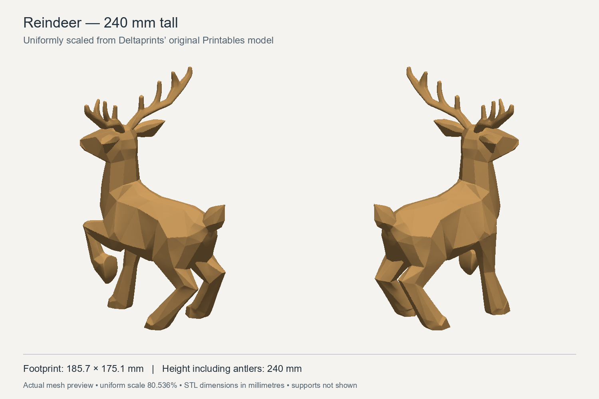

# Reindeer demonstration target

Open **Reindeer_240mm.3mf** in a 3MF-capable slicer or mesh editor at **100% scale, millimetres**. This is a geometry-only mesh model, not a configured slicer project, G-code, or editable parametric SolidWorks part. The creator did not provide native CAD in the downloaded source.

Dimensions: **185.708 x 175.149 x 240.000 mm**, with height including antlers. Lowest point is Z = 0. The model has 435,494 vertices and 870,988 triangles. Conversion preserves the prepared mesh coordinates and triangle topology; no mesh simplification or redesign was performed.

## Attribution and terms

**Minimalist (Christmas) low poly reindeer**, by **Deltaprints**. [Original model and creator](https://www.printables.com/model/1489726-minimalist-christmas-low-poly-reindeer).

Licensed under [Creative Commons Attribution-NonCommercial-NoDerivatives 4.0 International](https://creativecommons.org/licenses/by-nc-nd/4.0/); [full legal terms and warranty disclaimer](https://creativecommons.org/licenses/by-nc-nd/4.0/legalcode.en). Provided as-is, without warranties. This third-party model retains its own license, independently of project code. No creator endorsement is implied.

Technical preparation: original STL height 298.0032349 mm; uniform scale factor 0.8053603851, XY centering, lowest point placed on the bed, and lossless-coordinate mesh format conversion to 3MF. No changes to the sculpture's proportions or topology. Intended for the team's noncommercial demonstration; retain this attribution and license with shared copies.

## Printing

Two K2 Plus printers with stock 0.4 mm nozzles are planned; one for the car and one for this model. Keep this model upright. The creator's starting settings were 0.16 mm layers, 3 walls, 10% grid infill and automatic tree supports from the build plate. Inspect supports at the raised leg and antlers and consider a brim at the feet. Slice with the actual printer and PLA profile before making any time commitment. The six-hour goal has not been verified. No physical print has been started or validated.

Unheated PLA does not reproduce a warm animal's thermal signature. This is a visual/distance demonstration target, not a validation of real wildlife detection.
